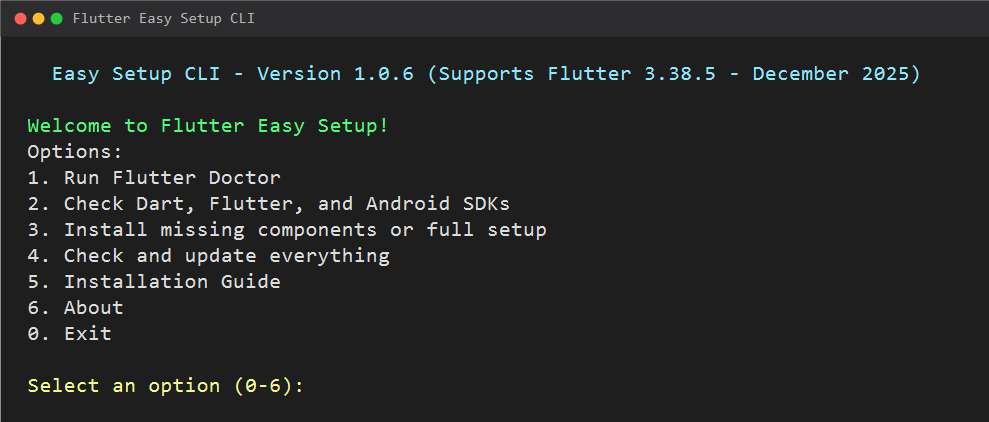
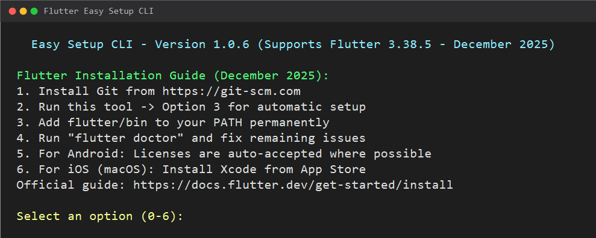
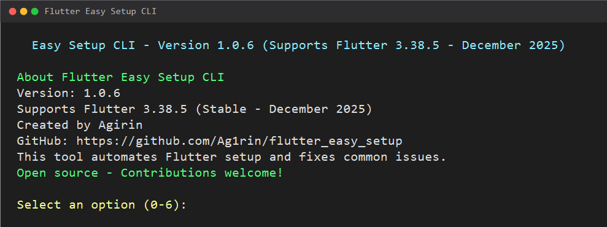

# Flutter Easy Setup

`fes` installs and repairs a Flutter toolchain on Windows, macOS, and Linux.
It checks the Flutter SDK archive with SHA-256 before extracting it, and it asks before it changes PATH or a shell startup file.
There is no telemetry.

[](https://github.com/Ag1rin/flutter_easy_setup/actions/workflows/ci.yml)


## Install

Download a binary from the [latest release](https://github.com/Ag1rin/flutter_easy_setup/releases/latest). The release also contains `SHA256SUMS`.

- Windows x64: `fes-windows.exe` or `fes-windows-x64.exe`
- macOS Apple silicon: `fes-macos` or `fes-macos-arm64`
- macOS Intel: `fes-macos-x64`
- Linux x64: `fes-linux` or `fes-linux-x64`
- Linux arm64: `fes-linux-arm64`

Or install from pub when Dart is already present:

```bash
dart pub global activate flutter_easy_setup
fes --version
```

`install.ps1` and `install.sh` download the release asset, check `SHA256SUMS`, and copy the binary into a local directory. They do not change PATH.

## Use

`fes` with no arguments opens the menu:

```text
1. Run Flutter Doctor
2. Check Dart, Flutter, and Android SDKs
3. Install missing components or full setup
4. Check and update everything
5. Installation Guide
6. About
7. Language / زبان
0. Exit
```

Option 3 installs Flutter into `~/flutter`. Scripted use:

```bash
fes install --flutter-version 3.24.5 --channel stable --dry-run
fes doctor --json
fes path --undo
fes mirror list
fes mirror set china
fes use 3.24.5
fes create my_app --template state
```

`--dry-run` prints the action and writes nothing. `--yes` confirms PATH edits, license acceptance, and deletes. `-v` prints the `fes` version, not a Flutter version.

## What it sets up

- The current Flutter stable archive for this OS and CPU, or a pinned version
- PATH, with a backup under `~/.fes/backups/` and `fes path --undo`
- Temurin JDK 17 under `~/.fes/jdks/`
- Android command-line tools, platform-tools, one platform, and build-tools
- On macOS, a confirmed `xcode-select --install` or CocoaPods install when doctor asks for it
- Several Flutter SDKs under `~/.fes/versions/`
- Project starters: `basic`, `state` (a small `ChangeNotifier`), and `clean`

Official Google storage is the default. Other mirrors, including `https://storage.flutter-io.cn`, are listed and applied only after you choose one.

## Compared with FVM and puro

[FVM](https://github.com/leoafarias/fvm) and [puro](https://github.com/pingbird/puro) pin Flutter versions for a project and integrate with editors. `fes` is a setup and repair tool: it downloads a verified SDK, repairs PATH, JDK, and Android command-line tools, and can keep more than one SDK. You can use `fes` to get a machine ready and still use FVM or puro inside a repository.

## Doctor questions

**cmdline-tools component is missing.** `fes doctor` can install the pinned Android command-line tools into `ANDROID_HOME` after you confirm.

**Android license status unknown.** After the tools exist, `fes` can pass `y` to `sdkmanager --licenses` only after a second confirmation or `--yes`.

**Waiting for another flutter command to release the startup lock.** `fes` deletes `~/flutter/bin/cache/lockfile` only after you confirm. It does not delete the lock during a normal install.

## Screenshots







A short demo belongs at `doc/demo.gif`. Record it with the steps in [doc/RECORD_DEMO.md](doc/RECORD_DEMO.md).

## Documentation

- [Persian README](README.fa.md)
- [Contributing](CONTRIBUTING.md)
- [Security](SECURITY.md)
- [Roadmap](ROADMAP.md)
- [Changelog](CHANGELOG.md)

## Author

Agirîn — [github.com/Ag1rin](https://github.com/Ag1rin)

## License

MIT. See [LICENSE](LICENSE).
